<div align="center">

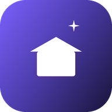

# Sky Home Launcher

**A fast, ad-free home screen for Google TV and Android TV.**

Trending picks from your own apps, the weather at a glance, and a look that follows the sunset.<br>
A fork of [Free My TV](https://github.com/simbasjungles/free-my-tv) — see [NOTICE](NOTICE) — rebranded and
Android-only. Open source. Built with Claude Code. One button to undo.

[Install](#install) · [Features](#what-you-get) · [Flows](#flows) · [Integrations](#integrations) · [Make it yours](#make-it-yours)

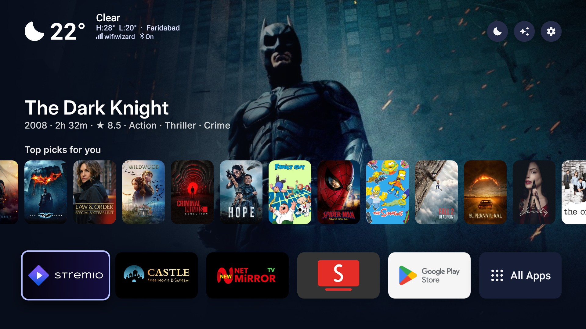

</div>

## What you get

- **No ads.** No sponsored rows, banners or autoplaying promos. Not one.
- **Your apps, front and center.** The streaming apps you actually use, on a glass shelf. Pick them and their order right on the TV.
- **Trending, not sponsored.** Three fresh picks every hour from what's trending this week and the latest releases, only from apps you already have. Movies and Shows get their own tabs.
- **A catalog screen with trailers.** Trending, popular, top-rated and more, in rows you choose — hold OK on a title and its trailer plays right there, inline.
- **Continue Watching, your way.** What you stopped part-way, the next episode of shows you follow, and your Trakt Watchlist, blended with Android TV's own Watch Next from your other apps.
- **Weather and markets, one press away.** The hour-by-hour forecast, sunrise and sunset, and live crypto prices.
- **Light by day, dark by night.** It follows your city's real sunset, the way your phone does — and switches between a frosted Liquid Glass look and Material 3 Expressive, your choice.
- **A screensaver to match.** Full-screen photos of the picks with a big glass clock.
- **Any remote, any button.** Press a button on your remote and Sky Home Launcher records it — not just the brand's own app buttons — and you choose what it opens.
- **Fast.** 60 fps, every frame in 16.6 ms, on the TV's own chip. The home screen uses far less memory than the stock launcher.
- **Set up on the TV.** Language, your city, temperature, theme, the weather and prices cards, which coins, the apps on the shelf, and which turned-off apps you want kept on, all in Sky Home Launcher's own settings.
- **Safe.** No root. Nothing is uninstalled. One button brings back the factory home screen.

| Looks: Liquid Glass (dark) | Material 3 Expressive (dark) | Material 3 Expressive (light) |
|---|---|---|
| 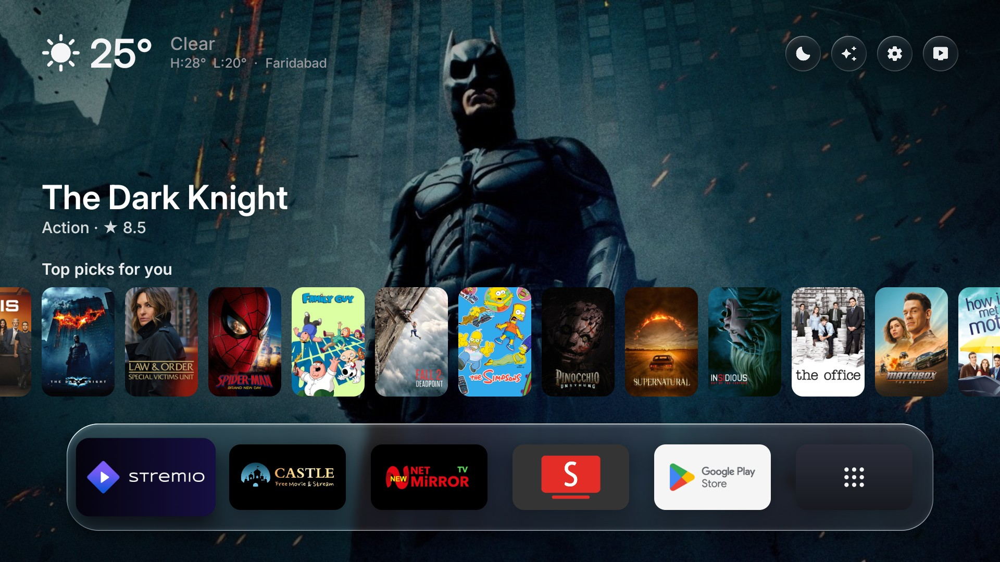 |  | 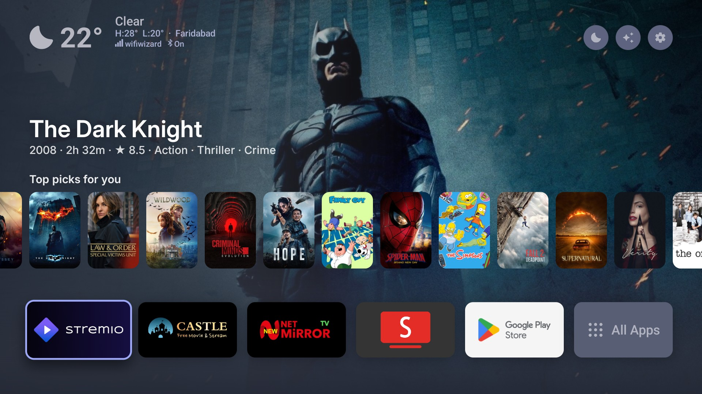 |

## Flows

**Browsing and trailers.** Scroll down from the shelf into the catalog screen: trending, popular movies and shows,
top-rated and more, each a row you can turn on or off. Hold OK on any poster and its trailer plays right there,
inline, no app switch.

| Trending, with a trailer ready | Popular movies |
|---|---|
| 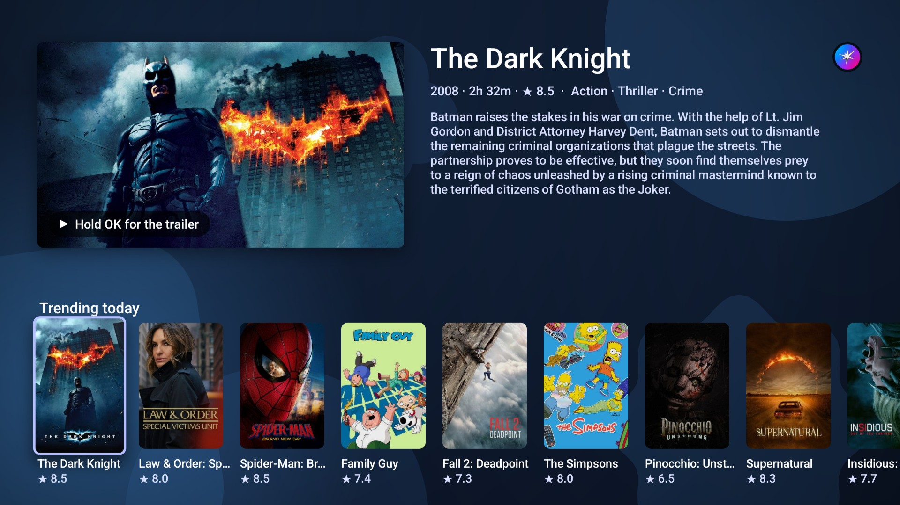 | 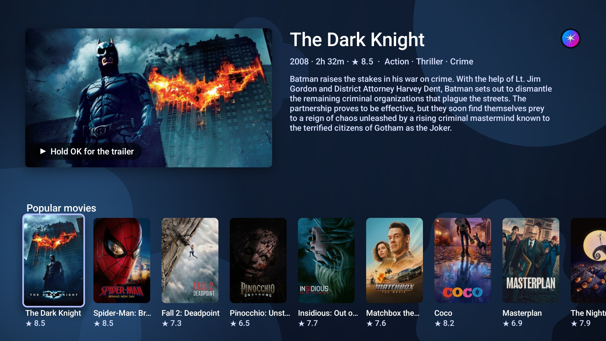 |

**Continue Watching and episodes.** Scroll up from the shelf for what you stopped part-way, the shows you watch, and
your watchlist — Trakt's lists blended with Android TV's own Watch Next from your other apps. Open a show for its full
episode list, with sort, season, date and watched filters; OK opens an episode in Stremio.

| Continue Watching, Shows you watch, Watchlist | Episodes, with filters |
|---|---|
| 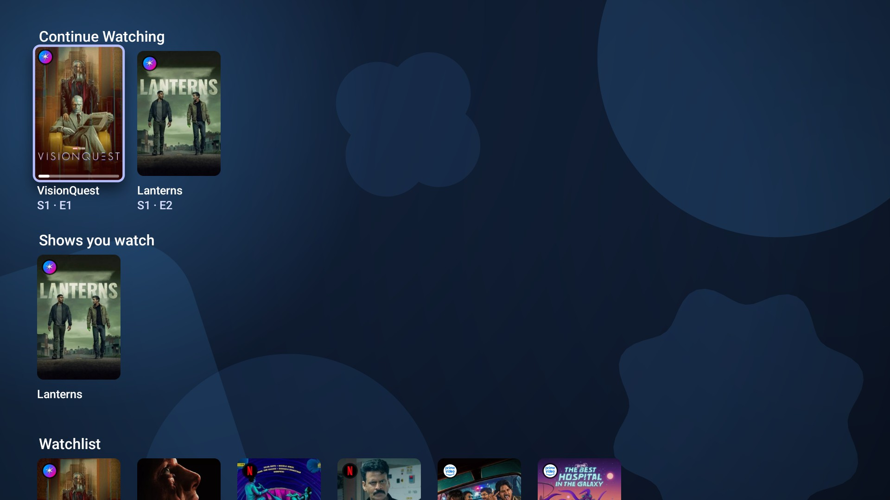 | 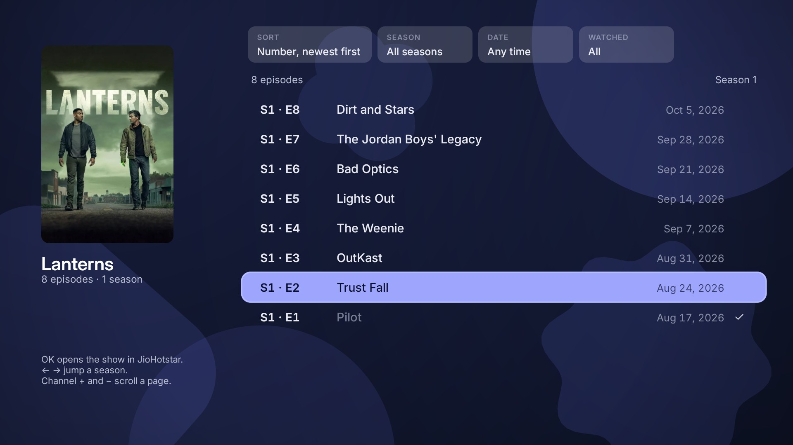 |

**The screensaver.** Full-screen photos of your picks, with a big glass clock, the forecast and sunrise/sunset.

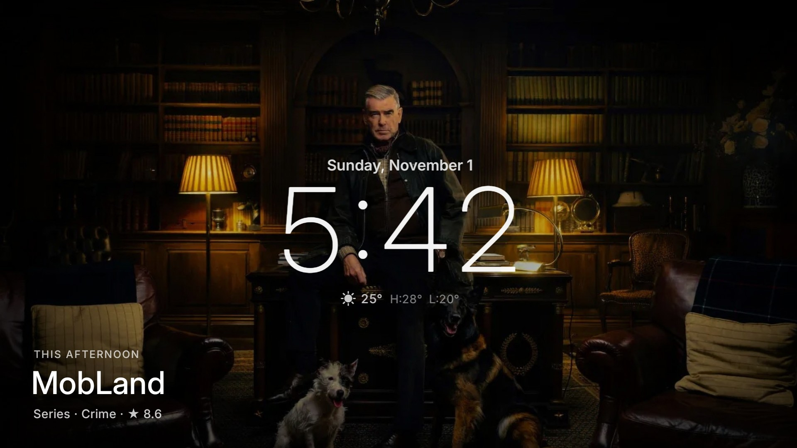

**Switching on and back.** On the TV: *Sky Home Launcher* → *Home Screen* → *Sky Home Launcher* changes the home
screen and screensaver, and turns off a short list of promo apps (never uninstalled). *Original* brings it all back,
exactly as it was.

**Settings.** Everything is set up on the TV, with the remote.

| Settings | Home Settings | Shelf |
|---|---|---|
| 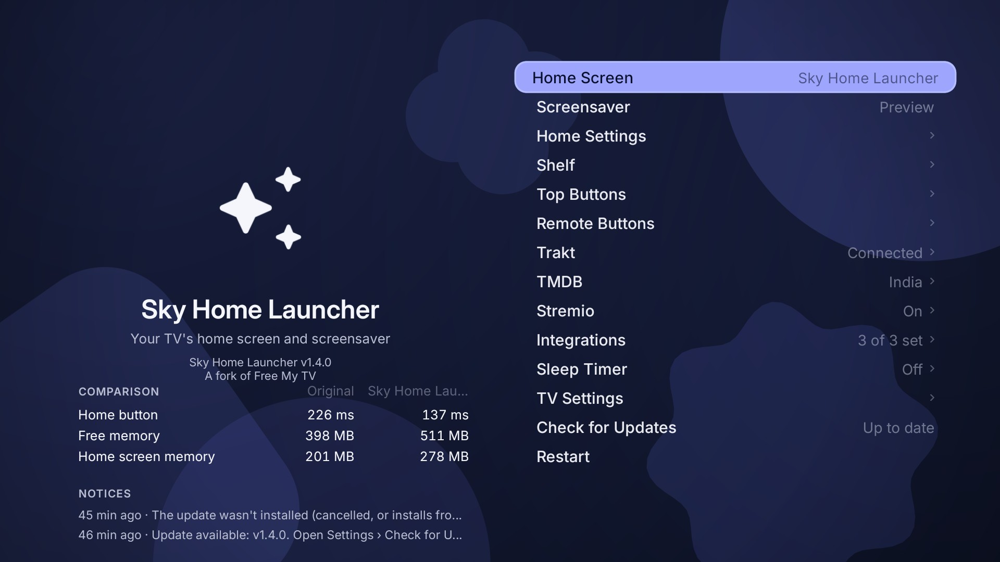 | 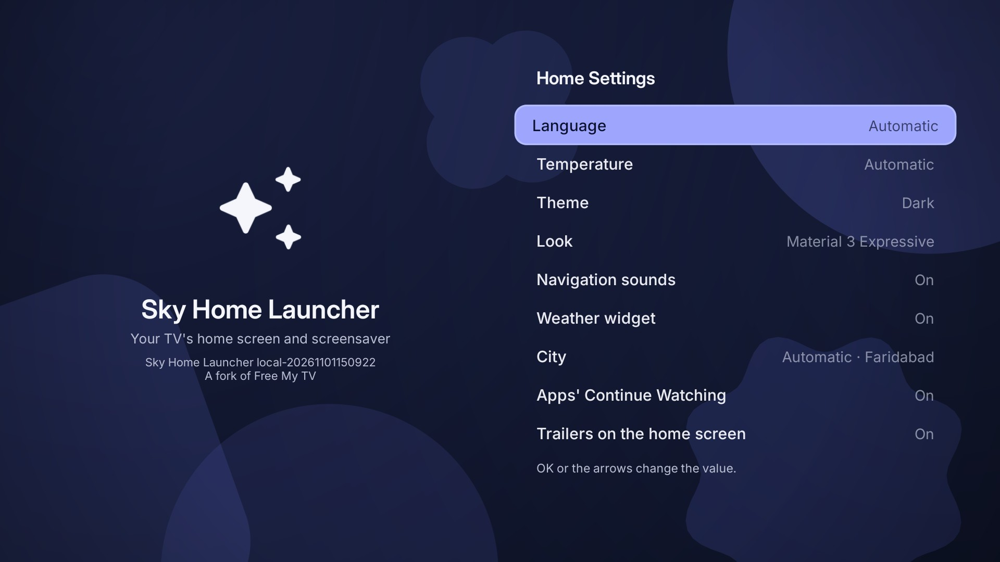 | 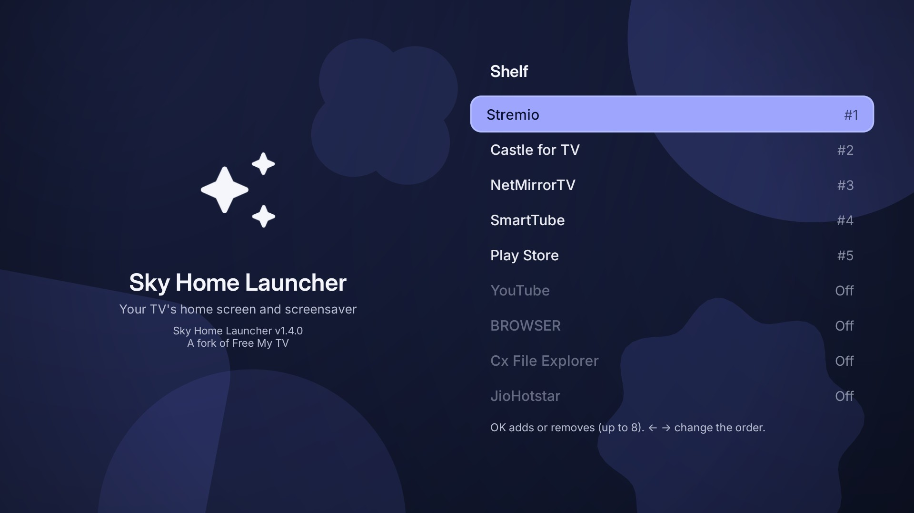 |

| TMDB | Stremio | Integrations |
|---|---|---|
| 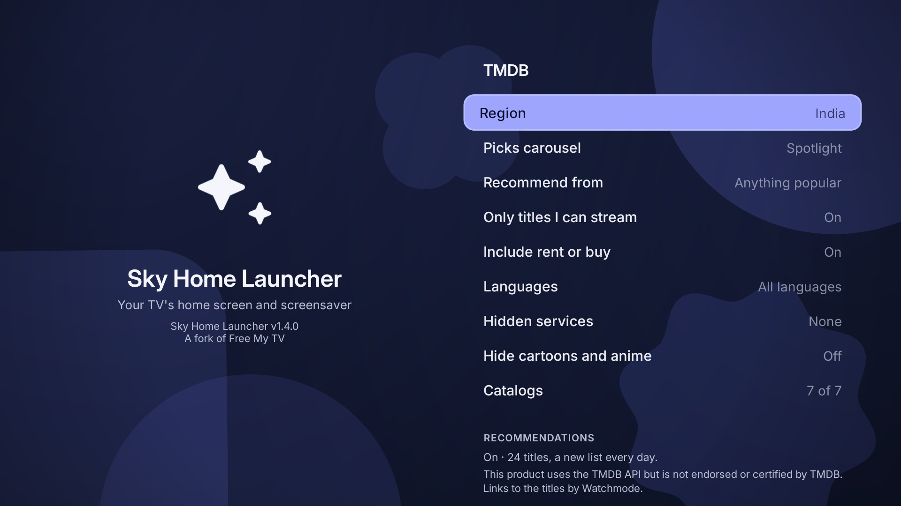 | 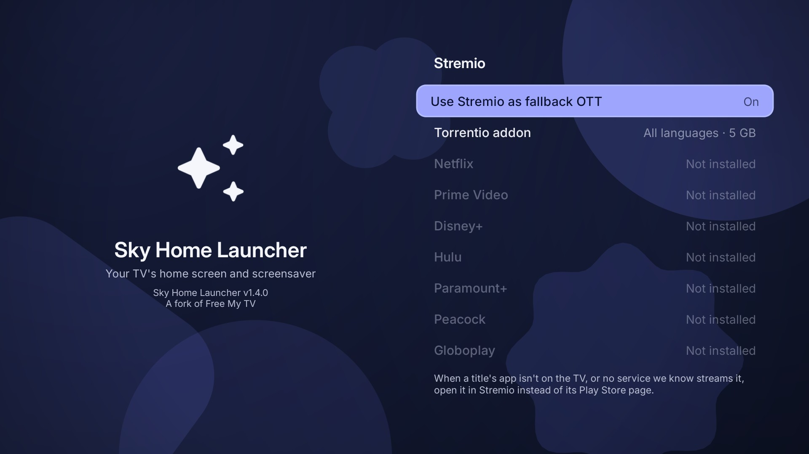 | 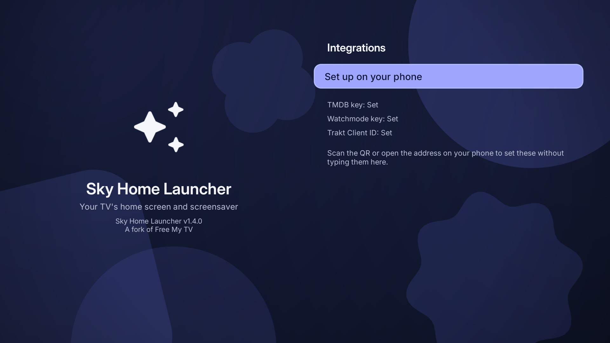 |

**Quick Settings.** A card that slides in from the right over any app, from a remote button: the Skyworth remote's gear
button opens it by default, and on any other TV you give it to a button in *Remote Buttons* (or to one you add under
*Added buttons*). The app underneath pauses; Back, or the same button again, closes it.

| The card | Notifications | Choosing the tiles |
|---|---|---|
| 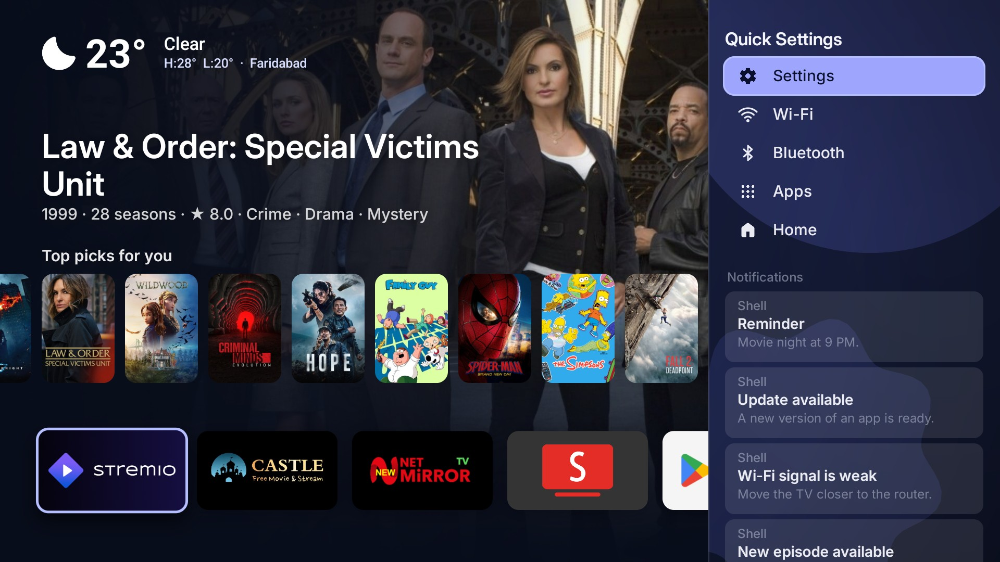 | 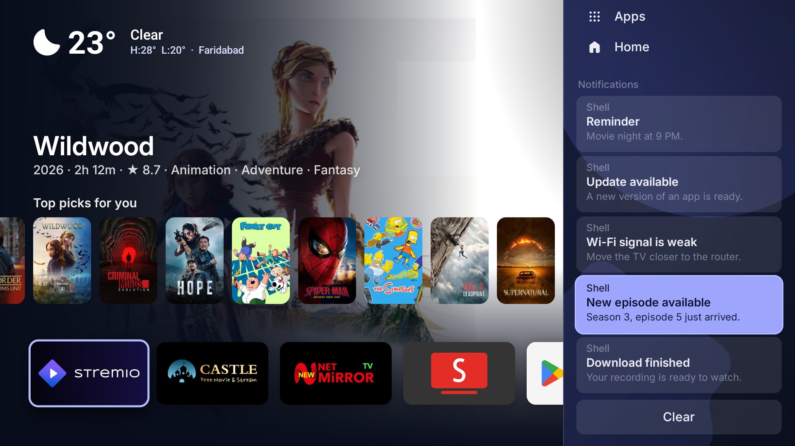 | 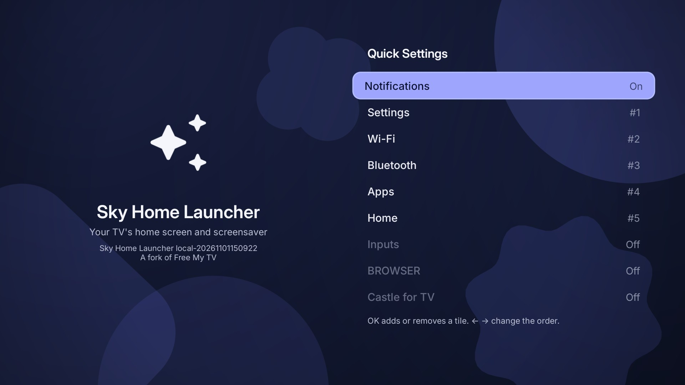 |

- **Tiles** open the TV's own screens, and never change a setting themselves: Settings, Wi-Fi, Bluetooth (the list of
  paired and connected devices, with *Pair remote or accessory*), one tile per input of the TV (HDMI, AV…), Home and Apps.
  Any installed app can be added as a tile that opens it.
- **Notifications** are listed under the tiles, newest first. OK on one opens its app; *Clear* clears them all (ongoing ones
  stay). Switching to Sky Home Launcher mode allows this through the TV's own ADB, and *Original* takes it back; where the TV
  refuses, the section says so and the tiles still work. Nothing is stored or sent anywhere.
- **Choose and order the tiles** in *Home Settings* → *Quick Settings tiles*: OK adds or removes a tile, ← → change the order, and
  *Notifications* turns that section on or off.
- It looks like the rest of Sky Home Launcher: the same moving background and focus, in the look (Liquid Glass or Material)
  and the light or dark mode you picked.

**Connecting Trakt, installing Stremio, adding Torrentio, setting keys from your phone, recording a remote button.**
These all happen in Sky Home Launcher's own Settings, each with a short on-screen walkthrough and (for Trakt and the
phone setup) a QR code — see [Integrations](#integrations) below for what each one does.

## Integrations

| Integration | What it does | Required? | Set up |
|---|---|---|---|
| **TMDB** | Trending/popular/top-rated catalogs, the hourly picks, and which app streams a title in your region | For the picks and catalogs | `config.properties` or on the TV (*Integrations*, from your phone) |
| **Open-Meteo** | Hour-by-hour forecast, sunrise/sunset, the day/night theme | Always on | No key needed |
| **Binance** | Live crypto prices on the home screen and screensaver | Optional | `show_crypto=true` in `config.properties` |
| **Watchmode** | A title opens its own page in the streaming app, not just the app's home | Optional | `config.properties` or on the TV (*Integrations*) |
| **Trakt** | Continue Watching and Watchlist rows under the home screen's cards; episode watched-marks | Optional | Connect on the TV (*Trakt* → *Connect*, a QR code) or set the Client ID from your phone (*Integrations*) |
| **Android Watch Next** | Continue Watching and Shows you watch also include what your other apps say you were watching, read on the TV only | On by default | A one-time permission prompt on the TV |
| **Stremio** | A fallback for titles whose app isn't on the TV, or that stream nowhere else; episodes open there too | Optional | *Stremio* → *Install* installs it from Stremio's own site, not the Play Store |
| **Torrentio** | A third-party Stremio addon that finds streams, with your choice of language and size limit | Optional | *Stremio* → *Torrentio addon* |

## Install

About ten minutes. You need a Google TV or Android TV (Android 8 or newer) and a computer on the same Wi-Fi.

### The easy way: an AI assistant

1. **On the TV**, turn on developer mode: Settings → System → About → press *Android TV OS build* 7 times. Then Settings → System → Developer options → turn on **USB debugging**. Write down the TV's IP address (Settings → Network & Internet).
2. **On your computer**, open an AI coding assistant ([Claude Code](https://claude.com/claude-code), Codex or Antigravity) and say:
   > Install Sky Home Launcher on my TV at 192.168.1.50. I live in Lisbon.

   It downloads the code, installs the tools it needs, builds the app and puts it on your TV, and asks before anything important. Swap in your TV's IP and your city.
3. **On the TV**, open *Sky Home Launcher* → *Home Screen* → *Sky Home Launcher*. That's when the TV asks *Allow USB debugging?* for Sky Home Launcher: tick *Always allow* and accept.

### The manual way

1. **On the TV**, do step 1 above.
2. **Tools:** a JDK (17+), the Android SDK command-line tools (build-tools 34, platform android-34) and adb. On a Mac:
   ```bash
   brew install --cask temurin android-commandlinetools android-platform-tools
   sdkmanager "build-tools;34.0.0" "platforms;android-34"
   ```
   On Linux, get OpenJDK 17, Android's command-line tools and adb from your package manager, then run the same `sdkmanager` line. On Windows, use Git Bash (which Claude Code uses there) or WSL.
3. **Build:**
   ```bash
   ./build.sh
   ```
   The first run creates `config.properties`. Set your [TMDB key](#the-tmdb-key) there, then run it again.
4. **Install:**
   ```bash
   adb connect 192.168.1.50:5555
   adb install -r SkyHomeLauncher.apk
   ```
   On TCL TVs, also let it run in the background (TCL blocks it by default, and the switch never starts):
   ```bash
   adb shell "appops set com.skyhome.launcher AUTO_START allow || appops set com.skyhome.launcher APP_AUTO_START allow"
   ```
5. **On the TV**, open *Sky Home Launcher* → *Home Screen* → *Sky Home Launcher*. The TV asks *Allow USB debugging?* once more, now for Sky Home Launcher itself: tick *Always allow* and accept.

## Settings

The first values come from `config.properties`, created by the first build. Most of them can also be changed on the
TV, in *Sky Home Launcher* → *Home Settings*, and the TV's choice wins:

| Key | What it does | Default |
|---|---|---|
| `tmdb_key` | Your free TMDB key, for the picks | empty |
| `tmdb_region` | Your country (two letters): which titles are on which app | `US` |
| `watchmode_key` | Optional, free [Watchmode](https://api.watchmode.com/) key: a title (pick, catalog or Trakt card) opens its own page in its app | empty |
| `trakt_client_id` | Optional, your free [Trakt](https://trakt.tv) Client ID: *Continue Watching* and *Watchlist* rows under the home screen's cards (see [Your Trakt lists](#your-trakt-lists-optional)) | empty |
| `hide_animation` | Leave cartoons and anime out of the picks | `false` |
| `flatrate_only` | `false`: picks and catalogs may be any popular title, not only ones on a subscription service in your region | `true` |
| `tmdb_languages` | Only titles whose original language is one of these (`en,hi,ko`), for the picks and the catalogs; empty for any. *TMDB* → *Languages* changes it on the TV | empty |
| `watch_next` | *Continue Watching* and *Shows you watch* also list what the TV's other apps say you were watching (Android's Watch Next; read on the TV, nothing leaves it), without repeating what Trakt lists. The TV asks once to allow reading it; *Home Settings* turns it on or off | `true` |
| `include_rent_buy` | `true`: picks and catalogs also include titles you can only rent or buy (with `flatrate_only` on) | `false` |
| `catalogs` | Catalogs below the drawer's weather and quotes (`trending`, `popular_movies`, `popular_shows`, `top_rated`, `now_playing`, `upcoming`, `hindi`); `none` for no rows | `trending,popular_movies,popular_shows,hindi,top_rated` |
| `language` | `auto` (follows the TV), or a language with a [translation](#translations) (`en`, `pt`, `es`, `de`, `ru`, `fr`, `ja`…) | `auto` |
| `show_crypto` | Show Binance crypto prices on home and screensaver | `false` |
| `currency` | Crypto prices in `USD`, `EUR`, `BRL`… | `USD` |
| `temperature` | `C`, `F` or `auto` | `auto` |
| `look` | The look the home screen starts with: `material3-expressive` or `glass` (Liquid Glass). *Home Settings* on the TV changes it | `material3-expressive` |
| `theme` | `auto` (dark from sunset to sunrise), `dark` or `light`. Also changeable on the TV | `auto` |
| `disable_assistant` | Also turn off Google Assistant | `false` |
| `screensaver` | `false` keeps the TV's own screensaver: Sky Home Launcher then changes only the home screen and the promo apps | `true` |
| `hide_services` | Streaming services to leave out of the picks even when their app is on the TV (`netflix`, `prime`, `disney`…), comma separated; for apps the TV ships that you don't subscribe to. *TMDB* → *Hidden services* sets them on the TV | empty |
| `pick_count` | How many picks the home screen rotates through, 3 to 12. At 3 it shows this hour's three; with more, left and right slide through them in a circle | 3 |
| `pick_rotate_seconds` | If above 0, the picks move by themselves this often while focus is not on them | 0 |

Changed something? Run `./build.sh` and install again. Keep `skyhome.keystore`: updates are signed with it.

*Sky Home Launcher* → *TMDB* → *Picks carousel* turns the picks (the cards under the tabs) on or off. On a TV short
of memory (a 720p UI, a low-RAM flag or under 1.5 GB) they start off, and so do the trailers played inside the home
screen and the catalog rows (unless you wrote your own `catalogs=`), because those hold the most memory; each can be
turned on there, and a TV with more memory starts with them on. Off, the tabs are gone and the home screen shows the
clock, the weather and the shelf; nothing is fetched for the picks, and the catalogs and Trakt rows stay.

The inputs are round buttons, not a row in a drawer. *Sky Home Launcher* → *Top Buttons* can hold *Live TV*, *AV
input* and *HDMI input* (a button shows only when the TV has that input). One input opens at once; with several HDMI
inputs, OK opens a small list under the button to choose from (a dimmed one has no device on it).

### The TMDB key

Free, and it takes two minutes: create an account at [themoviedb.org](https://www.themoviedb.org/signup), then open [Settings → API](https://www.themoviedb.org/settings/api) and request a developer key. Paste the *API Read Access Token* (or the *API Key*) after `tmdb_key=`. It's your key: `config.properties` stays out of git.

### Opening a title

A card in the catalogs, the Trakt rows or the picks opens **the app of the service that streams the title in your region** (`tmdb_region`): a Netflix title in Netflix, and so on. When that app isn't on the TV it opens the app's **Play Store page** (on a TV where Sky Home Launcher turned the app off, the page has an *Enable* button); when the title is on no service there, it says "This title is unavailable in your region." A title on several services goes by price first (subscription, then free, then rent or buy), and the card shows that service; when its app isn't on the TV it goes to Stremio if you chose that, else to the Play Store, rather than to a pricier copy on an app you have. Among services of the same price, one you have comes first. While the answer comes (one TMDB request, kept for a day) the card shows three blinking dots, and Back or moving away cancels it; if it takes over 3 seconds it says it couldn't check.

*Stremio* (when Stremio is installed) says which services open in Stremio on the title's page instead of in their own app, and *Use Stremio as fallback OTT* sends it the titles whose app isn't on the TV and the ones that stream nowhere we can check; when Stremio isn't on the TV, that row says *Install*: OK downloads Stremio's Android TV app from Stremio's own site (the link is made from Stremio's download list at api.strem.io, nothing fixed in the app) and Android asks you to confirm (the first time also to allow installs from Sky Home Launcher). The *Torrentio addon* row there adds the Torrentio addon to Stremio with the languages and the biggest size you choose (it starts with the TMDB section's languages and 5 GB, and remembers your last choice): Torrentio is a third-party addon that finds streams for Stremio, and Sky Home Launcher only hands Stremio its install link; Stremio asks you to confirm. The episodes screen opens the episode in Stremio, and any other app on the show. Where a title streams comes from TMDB, so it needs the TMDB key.

### Opening the title's page in its app (optional)

With a free [Watchmode](https://api.watchmode.com/) key (`watchmode_key=` in `config.properties`), a title opens its own page in the streaming app instead of the app's home, whether it comes from the picks, a catalog or your Trakt rows (not the TV's own Watch Next cards, which resume in their own app). The free plan (2,500 credits a month) is enough: each title costs two requests the first time you open it and is remembered after that. It works where the app takes the title's web address (tested: Prime Video and JioHotstar); where it doesn't, the title just opens the app, as without a key.

### Your Trakt lists (optional)

Free Trakt account. Three rows appear first under the home screen's cards: *Continue Watching* (what you stopped part-way and the next episode of the shows you follow, with a bar on what's part-way), *Shows you watch* (the one you watched most recently first; one you saw once, over a year ago, was a try and is left out) and *Watchlist*.

1. Create an app at [app.trakt.tv/settings/apps/api/new](https://app.trakt.tv/settings/apps/api/new). The form asks for a redirect URI that Sky Home Launcher never uses: put `urn:ietf:wg:oauth:2.0:oob`. There is no secret; copy the *Client ID*.
2. Paste it after `trakt_client_id=` in `config.properties`, run `./build.sh` and install again.
3. On the TV: *Sky Home Launcher* → *Trakt* → *Connect*. It shows a short code and a QR code: scan the QR code with your phone's camera (the code is already in the link), or open the address and enter the code. No password is typed on the TV, and Sky Home Launcher only reads your lists.

OK on a show in *Shows you watch* opens its episodes: every episode with its number and air date, watched ones marked, and a bar of four buttons on top: **sort** (number or date, newest or oldest first), **season**, **date** (last 7 or 30 days, this year, a year, not aired yet) and **watched** (all, unwatched, watched). The filters combine, *Clear filters* resets them, and the sort is remembered. It opens on the next episode you haven't seen; ← → jump a season, Channel + and − scroll a page, Back goes up to the buttons and then out; OK opens the episode in Stremio.

*Shows you watch* also includes recent shows published by the TV's apps in Android's Watch Next list, including apps' watchlists. A show's page lists its TMDB episodes; when Trakt is connected, Sky Home Launcher looks up watched marks there. A **Resume** row at the top reopens the app's Watch Next intent, and the matching episode is marked there too. Watchlist entries say **Watchlist** and open the app. Other episodes use the regular title routing. The same *Home Settings → Apps' Continue Watching* switch controls both Watch Next rows. Entries older than 60 days, or with no engagement time, are left out.

Other titles open as described in [Opening a title](#opening-a-title). *Trakt* → *Disconnect* forgets the sign-in. The rows follow what Trakt has: Stremio, for one, adds to your history only when you connect Trakt in its settings.

### Setting these keys from your phone (no rebuild)

If the TMDB key, Watchmode key or Trakt Client ID is missing, *Sky Home Launcher* → *Integrations* starts a small web
address on the TV itself (shown as text and a QR code) and stops it again when you leave the screen. Open that
address on your phone (same Wi-Fi as the TV) to paste in whichever of the three you have — each field links to where
to get it — without typing anything on the remote or touching `config.properties`. A key already set shows as dots;
leaving a field as it is keeps it.

## Going back

On the TV: *Sky Home Launcher* → *Home Screen* → *Original*. The factory home screen, screensaver and every app come back exactly as they were. If the new home screen ever crashes three times in five minutes, it switches back by itself.

To remove it for good, switch to *Original* first, then uninstall *Sky Home Launcher* (Settings → Apps). Uninstalled it while it was on? Install it again and pick *Original*: the list of what it turned off is kept in the TV's settings, so everything comes back.

## What it changes

- It becomes the home screen and the screensaver.
- It turns off, without uninstalling:
  - the stock home screen and screensaver (the screensaver stays with `screensaver=false`);
  - Google TV's recovery home, Play Games and YouTube Music;
  - on TCL TVs, the TCL Channel, messages, store demo, hotel menu, manuals, mirroring and logging apps;
  - on Philco TVs, AI PONT (promo channels and app downloads) and the manual;
  - on Multilaser TVs, Anoki's screen-content recognition (ACR), the store demo and the manual;
  - on KTC-made TVs (NextStar), Anoki's screen-content recognition (ACR), the store demo and the manual;
  - Google Assistant, only with `disable_assistant=true`.
- On TCL TVs, the remote's Netflix, YouTube and Prime buttons keep working through a small accessibility service that only reads those buttons. Pick what each one opens in *Sky Home Launcher* → *Remote Buttons*; *Original* turns the service off. On Vestel-made TVs (F&U and other store brands) and Xiaomi (Formovie) projectors the same goes for the Netflix button, and on KTC-made TVs (NextStar) for the Tabii button. On Sony TVs, the BRAVIA CORE, Netflix, Disney+, Prime Video, YouTube and Crunchyroll buttons (and Google Play, on remotes that have it) can each open the app you pick, or keep Sony's default.
- Any other remote button can be recorded in *Remote Buttons* → *Added buttons*: press it, and choose what it opens — an app, TV Settings, Sky Home Launcher's own Settings, or *Quick Settings*.
- *Quick Settings* (described under Flows above) is a card over any app that a remote button can open.
- *Sky Home Launcher* → *Sleep Timer* turns the TV off after 5 minutes to 4 hours, with the minutes left over any app (top center, or the corner you pick). It presses the remote's Sleep key through the TV's own ADB, so it works in Sky Home Launcher mode; *Original* stops it.
- Picture, sound, inputs, remote pairing, Google services and the Play Store are on a protected list, checked before every change, and so are Android's own pieces and factory menus. Before anything goes off, the TV is asked whether its inputs or its remote's Input key depend on it; those stay on.
- The setup app goes off before the stock home screen and comes back after it, so its recovery screen never takes over the Home button in between.
- Apps that saved a Wi-Fi network are never turned off, since Android would erase the network. If the TV's first setup saved yours, the switch asks you to forget the network and connect again in Settings first (saved networks out of range don't show there; Claude Code can remove them).

## Any Android TV

Sky Home Launcher runs on Google TV and Android TV: TCL, Sony, Hisense, Philips, Xiaomi, Vestel-made TVs (F&U), KTC-made TVs (NextStar) and more, plus streamers like Chromecast with Google TV, the Google TV Streamer, onn 4K and NVIDIA Shield.

**A TV that doesn't run Google TV or Android TV:** plug a Google TV streamer into HDMI and free that one. Same steps, same home screen.

**A different brand or model:** ask Claude. Sky Home Launcher is made to be adapted by AI. Open the folder in Claude Code and say *"set it up for my Sony"*: it reads your TV, finds its home screen and its promo apps, updates the lists below and walks you through a test. [CLAUDE.md](CLAUDE.md) tells it how.

| What | Where |
|---|---|
| Apps to turn off | `DEBLOAT` in [`HomeMode.java`](app/src/com/skyhome/launcher/HomeMode.java) |
| Apps never to touch | `PROTECTED` in the same file |
| Apps on the shelf | `SHELF` in [`HomeApps.java`](app/src/com/skyhome/launcher/HomeApps.java) |
| Your brand's live TV app | `LIVE_TV_APPS` in the same file |

## Make it yours

It's your code, and Claude Code finds its way around it. Try:

- *"Add Crunchyroll to the shelf."*
- *"Show the prices in euros."*
- *"Add Catalan."*
- *"Switch to the night look an hour after sunset."*

## How it works

- **A plain Android app, no Gradle, no libraries.** [`build.sh`](build.sh) runs aapt2 → javac → d8 → zipalign → apksigner and makes a ~1.5 MB APK. The version shown in Settings is the release tag for a published build, or `local-<timestamp>` for a build made on your own machine.
- **It uses the TV's own ADB, from inside the TV.** The app connects to `127.0.0.1:5555` with its own key (that's the *Allow USB debugging?* prompt) and runs the same commands you would: `cmd package set-home-activity`, `settings put secure screensaver_components`, `pm disable-user`. Nothing listens to the network.
- **Drawn by hand on one Canvas**, with Android 13 shaders for the frosted glass and the sky (plain fills on Android 8 to 12, with lighter shadows and no GPU layers on 8 to 11 for their older GPUs).
- **A safety net.** A watchdog in a separate process brings back the stock home screen after three crashes in five minutes, and a boot check keeps your choice after TV updates.
- **Data** from TMDB (trending titles, new releases and which app streams what in your country), Open-Meteo (forecast, sunrise and sunset), and optionally Binance (24-hour prices when `show_crypto=true`).

| File | What it is |
|---|---|
| [`HomeView.java`](app/src/com/skyhome/launcher/HomeView.java) | The home screen |
| [`HomeMode.java`](app/src/com/skyhome/launcher/HomeMode.java) | Switching between Sky Home Launcher and Original |
| [`Adb.java`](app/src/com/skyhome/launcher/Adb.java) | The TV's own ADB, from inside the TV |
| [`Recs.java`](app/src/com/skyhome/launcher/Recs.java) | The picks (TMDB) |
| [`HomeData.java`](app/src/com/skyhome/launcher/HomeData.java) | Weather and prices |
| [`HomeApps.java`](app/src/com/skyhome/launcher/HomeApps.java) | The shelf, inputs and All Apps |
| [`DreamView.java`](app/src/com/skyhome/launcher/DreamView.java) | The screensaver |
| [`SettingsActivity.java`](app/src/com/skyhome/launcher/SettingsActivity.java) | The settings screen (the app's icon) |
| [`Prefs.java`](app/src/com/skyhome/launcher/Prefs.java) | Settings changed on the TV |
| [`RemoteKeys.java`](app/src/com/skyhome/launcher/RemoteKeys.java) | The remote's app buttons |
| [`Watchdog.java`](app/src/com/skyhome/launcher/Watchdog.java) | The safety net |

## Translations

Each language is one file, [`app/assets/i18n/<lang>.json`](app/assets/i18n), keyed by the
English text in the code. *Automatic* follows the TV's language and uses any language that has a file (English otherwise); *Home
Settings* → *Language* lists them all. Today: English, Portuguese, Spanish, German, French, Italian, Dutch, Polish,
Swedish, Danish, Norwegian, Finnish, Czech, Romanian, Turkish, Russian, Ukrainian, Greek, Japanese, Korean, Simplified
Chinese, Hindi, Indonesian, Vietnamese and Thai. Portuguese, Spanish, German, Russian and Turkish were translated by hand and are the
reference (fix them by hand); the others were machine-made, and corrections from native speakers are welcome.

- **Add a language:** `python3 tools/translate.py --new ca`, then fill `app/assets/i18n/ca.json` by hand, or with
  `ANTHROPIC_API_KEY` set, `python3 tools/translate.py --fill --lang ca` (only the strings go to the API).
- **After changing text in the code:** `python3 tools/translate.py` lists what each language lacks; `--fill` translates
  only that, `--prune` drops strings the code no longer uses.
  Run `python3 tools/translate.py --check` to validate all catalogues without writing files.
- Text built at runtime has placeholders (`"{n} min ago"`), so each language puts the words in its own order. A key
  like `"unit|Automatic"` is the same English in another place, where a language may need another word.
- Counts have plural forms: `"plural|one:{n} season|other:{n} seasons"` is translated with one form per plural
  category the language uses (Russian `"one:{n} сезон|few:{n} сезона|many:{n} сезонов|other:{n} сезона"`, Japanese
  just `"other:{n}シーズン"`), and Android's plural rules pick the one for each number.
- **Limits:** right-to-left languages (Arabic, Hebrew, Persian) would need the layout mirrored, so they aren't there
  yet. Chinese, Japanese, Korean and Hindi are drawn with the TV's system font (Inter has no such letters).

## Privacy

No accounts, no analytics, no tracking. The app talks to TMDB, Open-Meteo (for your city, which the TV finds from its internet address through ipwho.is unless you choose one), and Binance only when `show_crypto=true`, Watchmode only when you set a `watchmode_key`, Trakt only after you connect it (your sign-in stays on your TV), YouTube only while a trailer plays in the home screen (and Stremio's site only if you press *Install* for Stremio). Your settings stay on your computer and your TV.

## Credits

- A fork of [Free My TV](https://github.com/simbasjungles/free-my-tv) — see [NOTICE](NOTICE) for what's changed.
- Built with [Claude Code](https://claude.com/claude-code).
- This product uses the TMDB API but is not endorsed or certified by [TMDB](https://www.themoviedb.org/).
- Links to the titles in the streaming apps by [Watchmode](https://api.watchmode.com/).
- Weather data by [Open-Meteo.com](https://open-meteo.com/) (CC BY 4.0). Prices from the [Binance](https://www.binance.com/) public API.
- Icons: [Material Symbols](https://fonts.google.com/icons) (Apache 2.0). Font: [Inter](https://rsms.me/inter/) (SIL OFL 1.1). Coin logos: [cryptocurrency-icons](https://github.com/spothq/cryptocurrency-icons) (CC0).
- Not affiliated with Google, TCL, LG, Samsung or any streaming service. App names and logos belong to their owners.

## License

[MIT](LICENSE). Fork it, change it, ship it.
