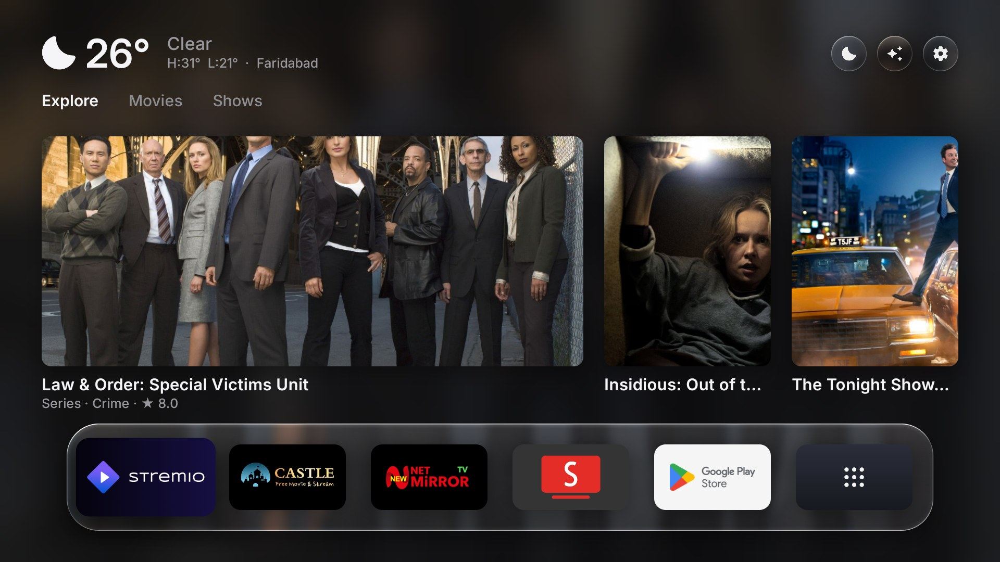
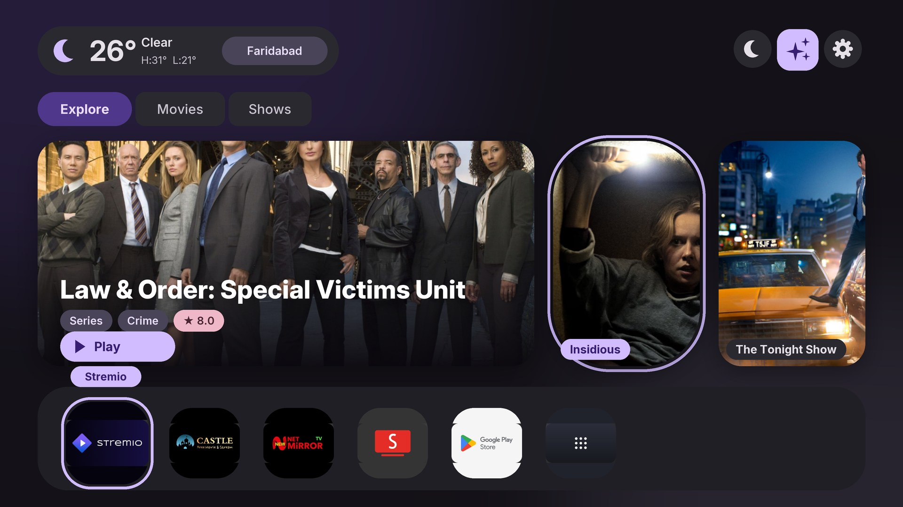
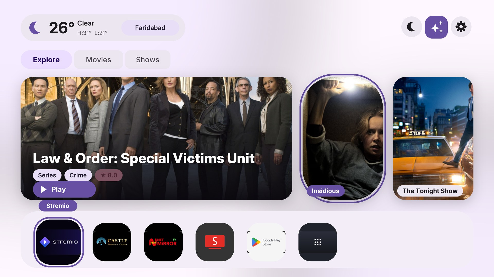

# Plan: more looks, starting with Material 3 Expressive

Status (2026-10-24): **draft for review, no code changed.** Mockups only. Answer the open questions at the end and I will start
with phase 0.

## Goal

Free My TV has one look: Apple-style liquid glass over an animated sky, in light or dark. This plan makes the look
**swappable**, so a second one (Google **Material 3 Expressive**) and later others can be added without touching every
screen again.

- A **Look** setting on the TV (*Home Settings*), separate from the existing **Theme** (automatic, light, dark), which keeps
  working inside every look.
- The current look stays exactly as it is, as *Glass*, and stays the default.
- The first new look is *Material*.

Not in this plan: the LG and Samsung apps (`web/`, a separate code base), a user-made look editor, and the screensaver's
photo slides (a look can restyle its caption later).

## The two looks side by side

Today (Glass, dark, on the Skyworth stick):



Material 3 Expressive, dark:



Material 3 Expressive, light:



The mockups are drawn by a script, not by the app; the posters and app icons are cropped from the real screenshot above. Icons
are plain shapes I drew, not Google's. They show the intent, not final pixels or motion.

### What changes, component by component

| Part | Glass (today) | Material 3 Expressive |
|---|---|---|
| Background | Animated sky from sunrise and sunset, blurred photo of the first pick | A soft wash of the primary and secondary container colours on the surface colour; no photo, no blur |
| Surfaces | Frosted glass, refraction, light rim | Flat tonal containers (`surface container` roles), no blur |
| Weather | Text over the sky | A rounded container with a city chip |
| Tabs | Text, a white pill on focus | Connected button group: selected = full pill in the primary container, others tonal rounded rectangles |
| Round buttons | Glass circles, focused one turns white | Tonal circles; the focused one **morphs** to a rounded square filled with the primary colour |
| Hero card | Photo with a text shadow | 48 px corners, a scrim, headline, genre and rating chips, a filled **Play** pill |
| Other picks | Tall rounded cards | Tall cards with **different corner radii** (expressive shape variety), a label chip on the photo |
| Focus | Lift and white rim | A thick primary ring, a larger size, a filled name chip; shapes morph, not just scale |
| Shelf | Glass capsule, icons grow | A tonal rounded bar, squircle app tiles, the focused one larger and ringed with its name in a chip |
| Drawer rows | Poster rows, text over the sky | Same rows; title text in the on-surface colour, progress bars in the primary colour |
| Settings and episodes | White focus rows over the sky | Tonal rows, filled-container focus, same text |

## Design tokens

The mockups use the Material 3 baseline (purple seed). A look is a set of tokens; nothing in a screen should hold a colour,
radius or duration of its own.

Colour roles (hex as drawn in the mockups):

| Role | Dark | Light |
|---|---|---|
| surface (background) | `#141218` | `#FEF7FF` |
| surface container | `#211F26` | `#F3EDF7` |
| surface container high | `#2B2930` | `#ECE6F0` |
| on surface | `#E6E0E9` | `#1D1B20` |
| on surface variant | `#CAC4D0` | `#49454F` |
| primary | `#D0BCFF` | `#6750A4` |
| on primary | `#381E72` | `#FFFFFF` |
| primary container | `#4F378B` | `#EADDFF` |
| on primary container | `#EADDFF` | `#21005D` |
| secondary container | `#4A4458` | `#E8DEF8` |
| on secondary container | `#E8DEF8` | `#1D192B` |
| tertiary | `#EFB8C8` | `#7D5260` |
| outline | `#938F99` | `#79747E` |

Other tokens:

- **Shape scale:** 12, 20, 28, 36, 48 px, and full. A look can give neighbouring items different radii.
- **Type:** Inter, which is already bundled (Google Sans Flex is not available to us). The sizes and weights come from the
  look: bolder, larger headlines than Glass.
- **Elevation:** one soft shadow for cards, none for the bar and chips (cached bitmaps in `Shadows`, as now).
- **Motion:** the existing `Spring`s with a slightly bouncier setting for the shape morph.
- **Seed colour (later):** the palette is computed once from a seed. A fixed set of five to six seeds (purple, teal, orange,
  green, blue, red) can be offered; a seed taken from the current pick's backdrop is a stretch idea (see *Later*).

No library is allowed (the project uses only the Android SDK). The tonal palette for a seed is generated offline with a small
script (`tools/make_palette.py`, a plain tonal ramp from HCT-like steps) into a table in the code; nothing is computed on the
TV.

## How the look is built today (what has to move)

- `HomeView` (about 3,300 lines) draws the home screen by hand on one canvas. It holds the colours (`L_INK`, `L_DIM`, `SMOKE`,
  `WHITE`...), the light or dark switch (`tone(light, dark)`, 41 calls), 18 direct `drawRoundRect` calls and 2 `Scene.liquid`
  calls.
- `Scene` (277 lines) draws the sky background and the glass; `Shaders` (351 lines) has the AGSL shaders (Android 13 and
  newer) and the fallback for 8 to 12.
- `SettingsActivity` (about 1,550 lines) and `EpisodesActivity` draw their own rows, with the white focus row, over the same
  `Scene`.
- `DreamView` (the screensaver) uses `Scene` for its background and draws its own Liquid Glass clock and captions.
- Light, dark or automatic is `Prefs.theme()`, decided in `HomeData.isNight` from sunrise and sunset.
- Older TVs (`Ui.LEGACY`, Android 8 to 11) skip GPU layers and use cached shadow bitmaps; some TVs draw at 1280×720. A new
  look must keep both.

## Design

One interface, two (later more) implementations:

```
interface Look {
    // colours, by role; `night` is the theme's answer, so Theme keeps working
    int color(Role role, boolean night);
    float radius(Shape shape);            // the scale above
    void background(Canvas c, ...);       // sky + glass, or the tonal wash
    void panel(Canvas c, RectF r, Shape shape, Role fill, float elevation);
    void chip(Canvas c, RectF r, Role fill, ...);
    void focus(Canvas c, RectF r, Shape shape, float amount);    // lift and rim, or ring and morph
    ...
}
```

- `GlassLook` is the current code moved behind the interface, **with no visible change**.
- `MaterialLook` is the new one.
- `Look.current()` reads `Prefs.look()` ("glass" or "material"); a change redraws like a theme change does today.
- Screens ask the look for everything they draw with a colour, a corner or a focus. What stays in a screen: layout, text
  content, animation targets.
- Frame rules stay: no allocations in `onDraw` (Paths, Paints and gradients are built once per size and look), 60 fps, and
  the legacy paths.

## Phases

Each phase ends with `./build.sh` passing and, for 0 to 3, **screenshots identical to the baseline** (no visible change).

0. **A screenshot harness.** A script (`tools/shots.sh`) that drives the TV with `adb` (home, drawer, every settings screen,
   episodes, screensaver; light and dark by setting the theme) and saves PNGs, plus a compare script that reports the pixel
   difference. Baseline shots of today's look. *Done when:* two runs of the same build differ by nothing (animations
   settled).
1. **Colours behind the interface.** `Look` with `color()` and `tone()` moved into `GlassLook`; the 41 `tone` calls and the
   named colour constants go through it. *Done when:* the screenshot difference is zero.
2. **Shapes, panels, focus and background behind the interface.** The direct `drawRoundRect` calls, the two `liquid` calls,
   the focus drawing and `Scene.drawBackground` go through `GlassLook`. *Done when:* zero difference, and the frame time on the
   Skyworth stick is the same (a measurement of 300 frames of the drawer opening).
3. **The other screens.** Settings and episodes use the look (the screensaver only if question 9 says so). *Done when:* zero difference.
4. **`MaterialLook`.** The palette table, the components in the mockups, the focus morph, the background wash (one cached
   bitmap or shader, rebuilt when the size or the theme changes), and the legacy path (flat fills, so cheaper than Glass).
   *Done when:* every screen reads well in both themes and matches the mockups, on the Skyworth stick and, if I can borrow
   one, a 1 GB 720p TV.
5. **The setting and the words.** *Home Settings → Look* (Glass, Material), the strings in 24 languages, README, the site and
   screenshots. *Done when:* switching looks on the TV redraws at once and survives a restart.
6. **Optional:** seed colours, a seed taken from the focused pick's backdrop, a third look.

## Where the setting goes

*Home Settings* already has 11 rows (12 with a Dollar row for `currency=BRL`) and the list runs to the bottom of the screen.
A *Look* row does not fit. Proposed: the *Quotes widget* row opens its own small screen with the coins (which frees four rows),
and *Look* sits next to *Theme*. A `look` key in `config.properties` gives the first value, like the other settings.

## Testing

- Phases 0 to 3: pixel comparison against the baseline, light and dark, for every screen.
- Phase 4: a manual checklist per screen and theme (focus on every kind of item, long titles, no picture, TalkBack text),
  plus the same frame measurement as phase 2.
- The palette generator gets a small JVM check (the roles meet the Material contrast steps).
- The usual `./build.sh`, `translate.py --check`, and the web builds, which must not change.

## Risks

- **Phase 2 is the big one:** 3,300 lines of drawing code move behind an interface. The harness is what keeps it safe; without
  it I would not start.
- A look that looks right on the Skyworth stick may not on a 720p, 1 GB TV (text sizes, memory): check before release.
- Two looks double the screens to review for every later design change.
- Expressive motion costs frames on weak GPUs; the springs stay on the existing animation system and the legacy path can drop
  the morph.
- Material's guidance is for phones and tablets; TV needs larger text, safe margins and a visible focus, which the mockups
  follow but the real Google TV home screen may differ from in details.

## Effort

Rough, for one developer with the TV at hand: phase 0 half a day, phase 1 one day, phase 2 three to four days, phase 3 one to
two days, phase 4 four to five days, phase 5 one day. About two weeks, most of it the refactor.

## Open questions

Mark an answer, or say "defaults". The *default* is what I would build.

1. **Go ahead with phase 0 and 1?** (default: yes, they change nothing visible and are the base for everything else.)
2. **Name and position of the setting:** *Look* next to *Theme* (default), or replace *Theme* with a two-level picker.
3. **Move the coin rows to their own screen** to make room (default: yes).
4. **Seed colour:** one fixed purple (default for the first release), or a choice of seeds from the start.
5. **Backdrop on the Material home screen:** none, tonal wash only (as in the mockup, default), or a faint blurred copy of the
   hero's photo.
6. **Focus feel:** the ring and shape morph of the mockup (default), or a quieter lift and tint.
7. **Fonts:** keep Inter (default), or look for a Google-Sans-like open font to bundle.
8. **Which TVs must the Material look run on at launch?** (default: Android 8 and newer like today, with the flat legacy path.)
9. **Should the screensaver follow the look?** (default: not in this plan.)
10. **Anything in the mockup you want different?** Colours, corner sizes, the Play button, the chips, the shelf.
