# Plan: minor improvements

A running list of small changes. Each item is its own section (`## N. Title`); add the next one at the bottom.
Each section says: what is wanted, where it lives in the code, how to do it, and what is still to decide.

Status (2026-10-25): all items go in **one** pull request, branch `minor-improvements` (off `main` after the catalog screen
merged). Built so far: items 1 to 6. Screenshots of what was built sit under each item (`plans/images/minor-improvements/`,
taken on the TV); a finished item has a *Built* line and its screenshots.

---

## 1. Toasts and notices follow the Material look

**Wanted.** In the Material look the toast (and any notice or error message) still looks like Liquid Glass. It should look like
Material: a solid surface, Material's shape and text colors.

**Where.** `HomeView.drawToast` (the toast layer) and `toastPaint`; the look layer (`Look`, `Themes`, the Material look) already
styles cards, tabs and rows, so the toast should get a hook there too (for example `look.toast(...)`), with the glass drawing as
the default. Also look for toasts in `SettingsActivity` (its own drawing) and for any plain Android `Toast` (those can't be
themed).

**How.** Add the hook to `Look`; Liquid Glass keeps today's drawing; Material draws a solid container (small rounded corners,
the look's surface and on-surface colors, a leading icon in the accent color) and sets the text color from the look.

**To decide.** Only the home screen's toasts, or the settings app's too. Day and night colors come from the look.

**Built (home screen).** `Look.toast()` / `Look.toastInk()` (the glass keeps its pill); `MaterialLook` draws a snackbar in the
inverse surface (two new palette roles) with a small shadow and corner radius 20, and the text and bell take its ink. Not done:
the episodes screen uses Android's own `Toast` (can't be themed), and the settings app has no toasts.

| Material, dark theme (light snackbar) | Material, light theme (dark snackbar) | Liquid Glass (unchanged) |
|---|---|---|
| 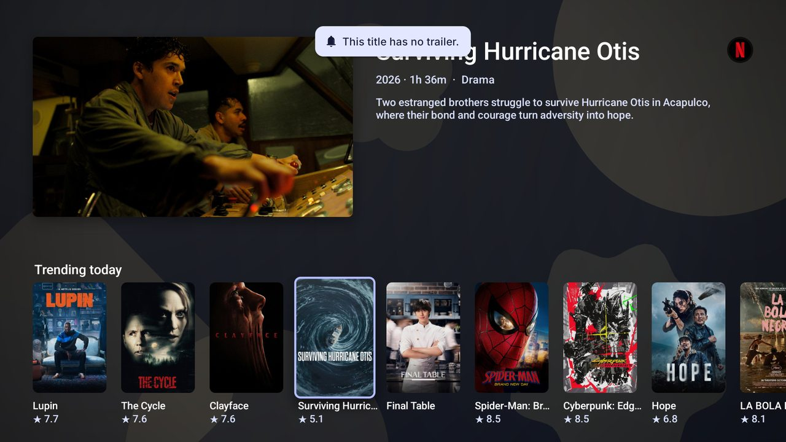 | 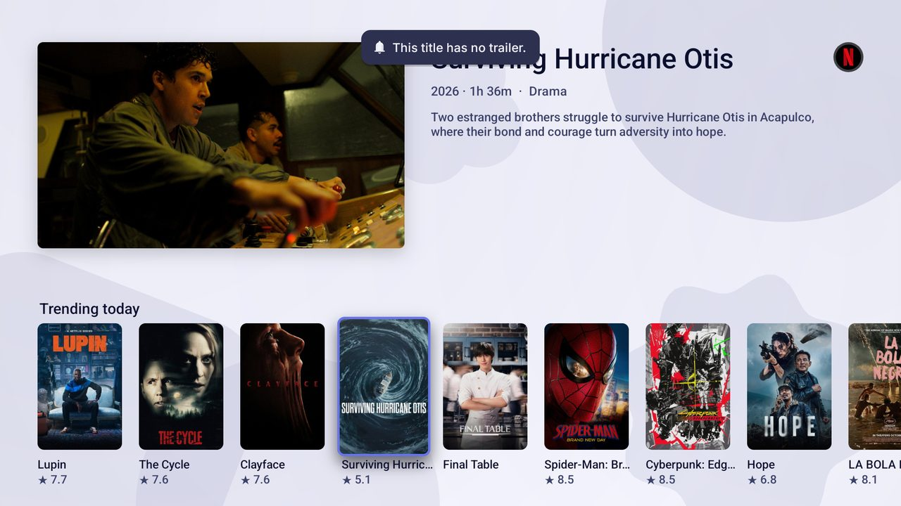 | 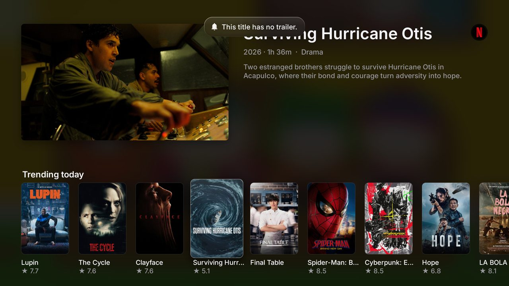 |

---

## 2. No service icon on the catalog screen's posters

**Wanted.** On the new catalog screen (page 3) the posters show the service badge, but the details card above already shows
it, so it is a duplicate. Remove it there. Trakt's rows, Continue Watching and Watch Next keep their badges.

**Where.** `HomeView.drawPoster` is shared by `drawCatalog` (Trakt rows) and `drawBrowse` (TMDB catalogs). The badge line is
`drawBadge(c, cell, catalogService(it, f > 0.5f))`.

**How.** Give `drawPoster` a flag (`badge`), true from `drawCatalog`, false from `drawBrowse`. The browse posters then also stop
asking `Launcher.service()` for each title (fewer requests); the details card gets its logo from `Details`.

**To decide.** Nothing.

**Built.** `drawPoster(..., badge)`: true for Trakt's rows and Continue Watching, false on the catalog screen (so it also stops
asking for each poster's service there).

| Screen 2: Trakt rows keep their badges | Screen 3: catalog posters have none (the card shows the service) |
|---|---|
| 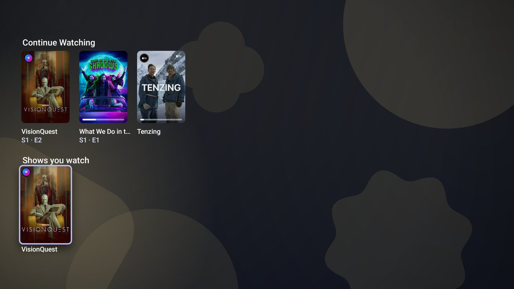 | 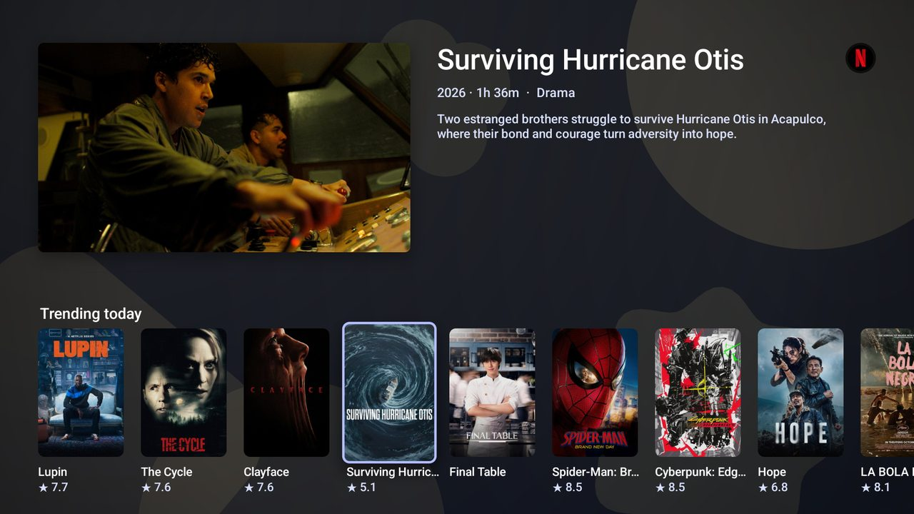 |

---

## 3. Let the person keep apps the switch turns off (debloat)

**Wanted.** Switching to Free My TV turns off a list of promo apps (`HomeMode.DEBLOAT`). Make that configurable so the person
can keep any of them on.

**Where.** `HomeMode.DEBLOAT` (the list), `HomeMode.PROTECTED`, `mayTurnOff` and the `targets` order; `Prefs` for the person's
choice; a new screen in `SettingsActivity` (it already has list screens, like Hidden services, to copy).

**How.**
- New pref `keepApps` (a set of package names), read by `HomeMode` when it builds the list to turn off: a kept app is skipped.
- Settings screen *Free My TV > Apps turned off*: the DEBLOAT apps that are on the TV, each with *Turn off* / *Keep on*, with the
  app's name from the package manager. Apps in `PROTECTED`, `CORE` and `FACTORY` are never listed.
- A change **applies at once** (decided): keeping an app that is already off turns it back on right away (`pm enable`, through
  `HomeMode`, like *Original* does), and turning one off again disables it right away. That needs the TV's debugging allowed, as
  the switch does; without it the screen says what to allow.
- Keep the rules in `CLAUDE.md`: only `pm disable-user`, always reversible, *Original* still brings everything back.

**Decided.** Changes apply immediately; the settings screen is enough (no `keep_apps=` line in `config.properties`, so drop it
from *Where* and from `build.sh`).

**Built.** *Home Screen* now has a third row, *Apps turned off*, with a list of the `DEBLOAT` apps this TV has (never the
protected, core or factory ones): OK keeps one on or lets the switch turn it off again. `HomeMode.setKeepOn` saves the choice in
the state file (`keepOn`) and a new job (`ModeJob.KEEP`) applies it at once: a kept app that is off is turned on, an app no longer
kept is turned off again by the verify pass. The switch and the verify pass skip kept apps. Tried on the TV: keeping YouTube
Music on turned it on within seconds ("Kept on: …" notice), and un-keeping turned it off again.

| Home Screen: the new row | Apps turned off | A kept app |
|---|---|---|
| 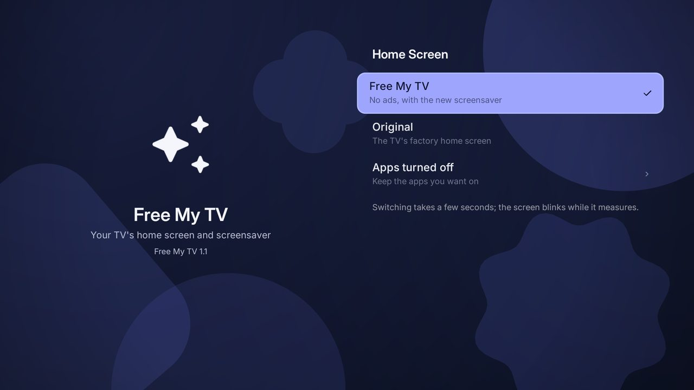 | 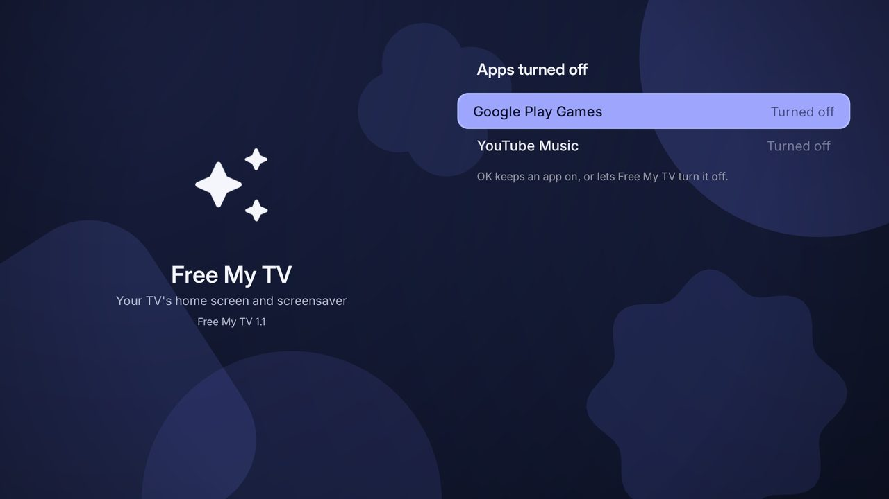 | 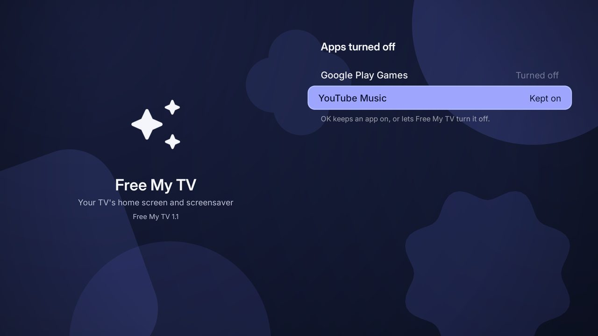 |

---

## 4. Install Stremio from its official site, not the Play Store

**Wanted.** When Stremio isn't on the TV, don't just grey out the Stremio rows in Settings: offer to install it, from Stremio's
own site, not the Play Store. No hard-coded links; build them from Stremio's API.

**Where.** `SettingsActivity` (`STREMIO_ROW` is disabled while `!stremioOn`; the Stremio screen), `Recs.stremioInstalled()`,
the manifest (a permission to install packages), a small new class for the download and install, the README, the site's
privacy answer and `CLAUDE.md` (a new network request).

**How.**
1. `GET https://api.strem.io/downloads/config`. The entry with `id` `android_tv` has
   `{"versionName": "1.11.3", "tag": "v1.11.3", "versionCode": {"arm": "41048579", "arm64": "43145731", "x86": "42097155", "x86_64": "44194307"}}`.
2. Pick the TV's ABI from `Build.SUPPORTED_ABIS` (first match): `armeabi-v7a` → `arm`, `arm64-v8a` → `arm64`, `x86` → `x86`,
   `x86_64` → `x86_64`.
3. Build the link: `https://dl.strem.io/android/{tag}-androidTV/com.stremio.one-{versionName}-{versionCode[abi]}-{abiName}.apk`
   (for example `…/v1.11.3-androidTV/com.stremio.one-1.11.3-43145731-arm64-v8a.apk`). Don't use the beta entry.
4. Download it to the cache with a progress line, then install it with `PackageInstaller` (the TV asks once to allow installs
   from Free My TV), or through the TV's own ADB (`pm install`) if the person already allowed it: decide below.
5. In Settings, with Stremio missing, the row says *Install Stremio* (one OK press starts the steps above), then the normal
   Stremio screen opens when it is installed. Errors (offline, no matching ABI, install refused) say what happened.

**Decided.** `PackageInstaller` (Android's standard installer), because it doesn't depend on the TV's debugging. The API gives no
checksum, so the download is only checked to be the package `com.stremio.one` before it goes to the installer (a different file is
refused). The open-in routing (Play Store pages for other apps) is not changed.

**Built.** `StremioInstall`: reads `api.strem.io/downloads/config` (entry `android_tv`), builds the link from the tag, version and
the TV's processor (`Build.SUPPORTED_ABIS`), downloads it with a progress line, checks the package, and hands it to
`PackageInstaller`; its receiver (`:home`) opens Android's confirmation. In Settings the *Stremio* row, when Stremio isn't on the
TV, says *Install* and shows *Downloading n%*, *Installing…* and *Confirm on the TV*; a cancelled or refused install leaves a
notice. The README, the site's privacy answer (English and Portuguese) and `CLAUDE.md` mention it. Tried on the TV with a
temporary build that pretended Stremio was missing (the TV has Stremio 1.6.12 and I did not upgrade it): the link built to
`…/v1.11.3-androidTV/com.stremio.one-1.11.3-41048579-armeabi-v7a.apk` (this TV is 32-bit ARM) and answered 200, the download ran
and passed the package check, and Android's prompt came up (*your TV currently isn't allowed to install unknown apps from this
source*, with *Settings* and *Cancel*); I chose Cancel, so nothing on the TV changed.

| The row says Install | Downloading | Confirm on the TV | Android asks (first time) | After Cancel |
|---|---|---|---|---|
| 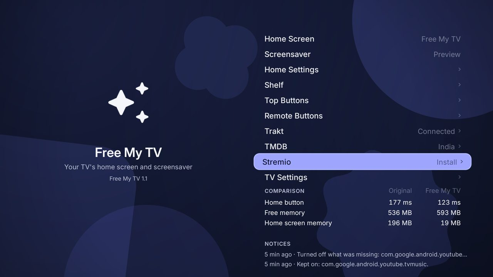 | 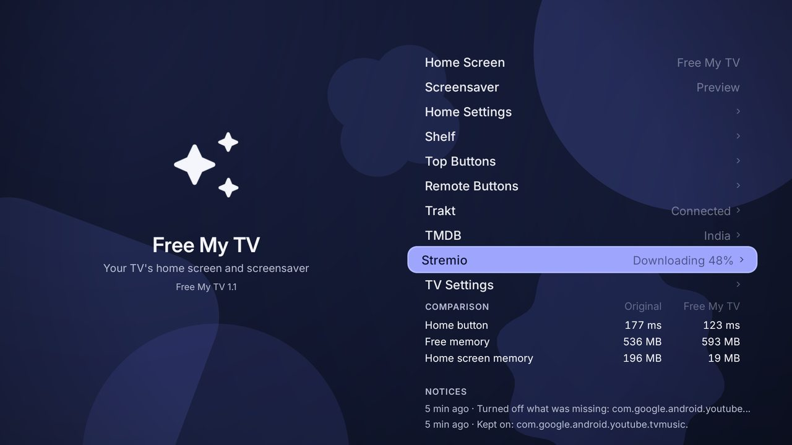 | 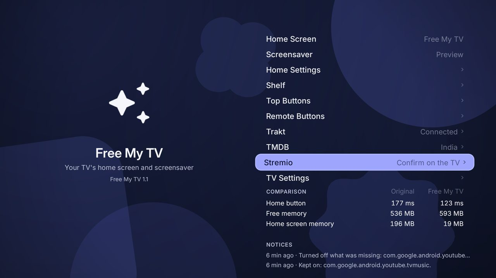 | 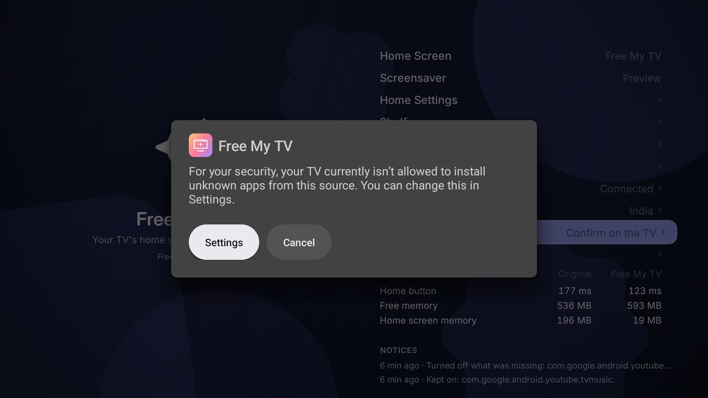 | 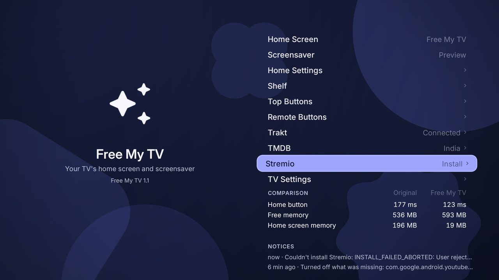 |

---

## 5. Add the Torrentio addon to Stremio from a section in the app

**Wanted.** A section in the Stremio screen that installs the Torrentio addon with the person's choice of language and size
filter, for example
`stremio://torrentio.strem.fun/language=hindi%7Csizefilter=5GB/manifest.json`.

**Where.** `SettingsActivity` (the Stremio screen, `openStremio`), `Prefs` (the last choice), a small helper that builds the link.

**How.**
- A new screen *Stremio > Torrentio addon* with two pickers: **Language** (one or several; none means all) and **Size limit**
  (no limit, 1 GB, 2 GB, 3 GB, 5 GB, 10 GB…), and an **Install** button.
- **Defaults and memory (decided).** The last choice is remembered (`Prefs`). The first time, the size limit is **5 GB** and the
  language is the same one the TMDB section uses (`Prefs.languages()`, the TMDB language list; the first entry, or all when it
  is empty), mapped to Torrentio's own language names.
- The link is `stremio://torrentio.strem.fun/` + options joined with an encoded `|` (`%7C`) + `/manifest.json`, with
  `language=hindi,english` and `sizefilter=5GB`; with no choice made, an option is left out. Opened with `ACTION_VIEW`: Stremio
  shows its own install confirmation.
- Needs Stremio on the TV, so it follows item 4: with Stremio missing, the section offers the install first.

**Decided.** It goes in the public build, with the README saying plainly what Torrentio is (a third-party addon) and the person
choosing to install it. The last choice is remembered; first defaults are 5 GB and the TMDB language. The languages are
Torrentio's own list (41, read from its configure page; English is its default and isn't listed), shown by name in the TV's
language; the sizes are no limit, 1, 2, 3, 5, 10, 15, 20 and 30 GB. A TMDB code maps by its language (`hi` to `hindi`, `pt-BR` to
`portuguese`, `zh-TW` to `taiwanese`, `es-419` to `latino`; `en` has none).

**Built.** *Stremio > Torrentio addon* (a new row under the fallback one): a screen with *Language* (a list with checks; none
means every language), *Size limit* (OK or the arrows step through the sizes) and *Add to Stremio*, which opens
`stremio://torrentio.strem.fun/language=…%7Csizefilter=…/manifest.json` in Stremio (`Torrentio` builds it; `Prefs` keeps the
choice). The first time, the languages are the TMDB section's and the size is 5 GB; this TV has no TMDB languages, so it showed
*All languages · 5 GB*. Tried on the TV: with Japanese and Hindi picked, Stremio opened the addon's own page with the URL
`https://torrentio.strem.fun/language=japanese,hindi%7Csizefilter=5GB/manifest.json`; I did not press its Install button, and I put
the choices back afterwards. The README says what Torrentio is.

| Stremio screen | The Torrentio screen | Languages | What Stremio shows |
|---|---|---|---|
| 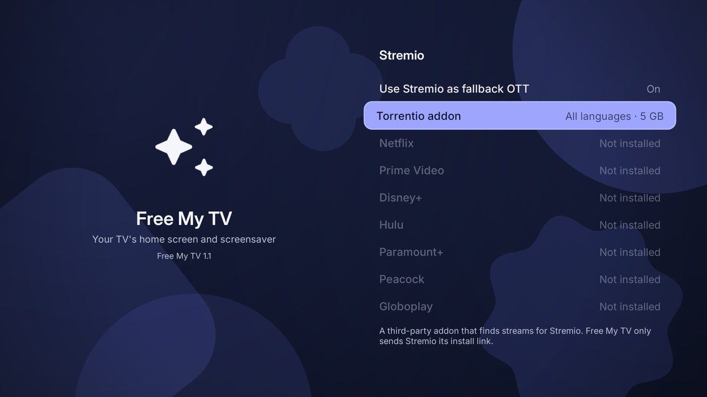 | 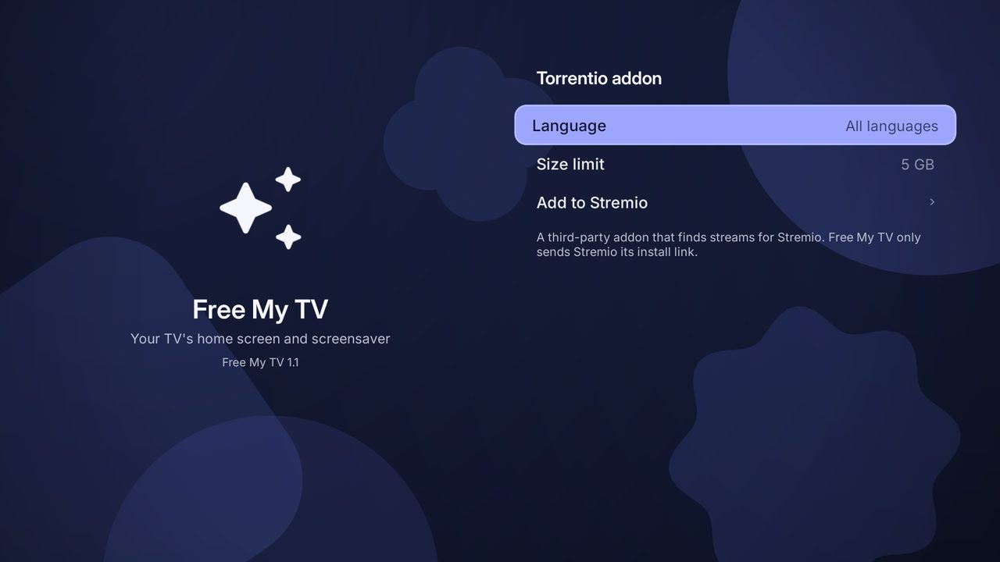 | 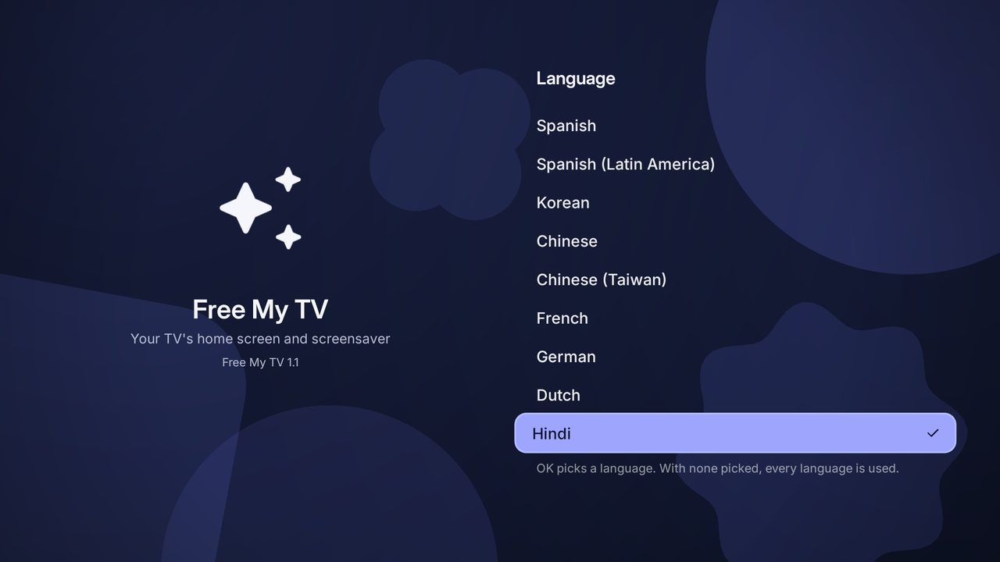 | 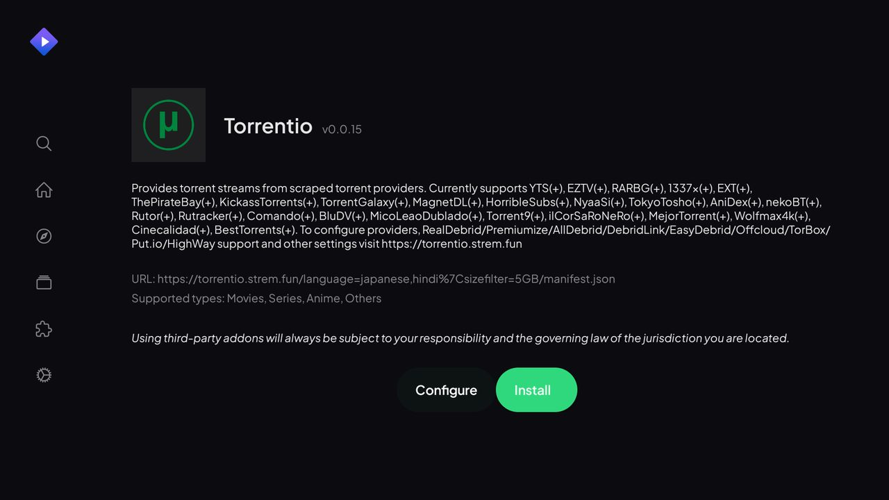 |

---

## 6. Learn the remote's buttons instead of hard-coded key codes

**Wanted.** Setting up a remote (the Skyworth one needed it) shouldn't mean someone reads key codes from a log and adds them to the
code. In *Free My TV > Remote Buttons* the person presses a button on their remote, the app records it, and they choose what it
opens. Any button can be added, not only the brand's Netflix, YouTube and Prime ones.

**Where today.** `Prefs.KEYS` and the `KEY_*` constants (TCL's 4062 and 190, Sony's `SONY_KEY` + scan code, Skyworth's STEM_1, F8,
F6...), `RemoteKeys` (`supported()` runs only on TCL, Vestel, KTC, Sony, Formovie and Skyworth), `RemoteKeyService` (the
accessibility service whose key filter is the only thing that sees some buttons: the YouTube button never reaches an app's
window), `Prefs.keyApp` / `setKeyApp` (saved in `remote-keys.txt`, never in SharedPreferences, because the service lives in its own
process `:keys`), and the Remote Buttons screen in `SettingsActivity` (`REMOTE_KEYS`).

**How.**
- **Record.** *Remote Buttons > Add a button*: a prompt "Press the button on your remote". The settings app can't see most of
  these keys (they are consumed before the window), so the recording is done by `RemoteKeyService`: the screen writes a request
  to the same shared file, the service's key filter takes the next key, writes `{keyCode, scanCode, device vendor id, name}`
  back and swallows it, and the screen shows "Recorded: Button 9 (scan 583)". If the service isn't on (Free My TV mode off), the
  screen says so and how to switch it on. A timeout (15 s) cancels.
- **Never recordable.** The arrows, OK, Back, Home, Menu, volume, mute and power: a wrong recording must not lock the person out.
  Say so on the screen ("This button is needed to move around").
- **Save.** The list of recorded buttons lives in `remote-keys.txt` next to today's lines, as `learned=<keyCode>:<scanCode>:<name>`
  (the scan code is stored because Sony sends one key code for five buttons). `Prefs.KEYS` becomes the built-in list plus the
  learned ones; `RemoteKeys.onKey` matches on key code, and on scan code when one was recorded.
- **Brand gate.** A learned button works on any brand (the person recorded it on their own remote); only the built-in codes stay
  gated by `supported()`.
- **Choose what it opens.** The same picker as today (an app, *TV Settings*, or the brand default), plus a name the person can
  edit. A learned button can be renamed, changed or removed; a *Reset buttons* row removes every learned button.
- **Safety.** Learned buttons run only in Free My TV mode, as the service does; *Original* takes the service out of the enabled
  accessibility services, so the original behaviour comes back untouched. Keys from a gamepad or joystick stay ignored.

**Decided (my call, none was asked for).** An added button opens an app or *TV Settings* (what a built-in button can do); other
actions can come later. The built-in brand presets stay as they are and the added buttons come on top of them.

**Built.** *Remote Buttons* has a last row, *Added buttons* (a list of up to 8, then *Add a button*). *Add a button* shows
*Press the button on your remote* and waits up to 30 s: `RemoteKeyService` (or the screen itself, for a key that reaches it)
takes the first key that isn't one of the arrows, OK, Back, Home, Menu, volume, mute or power, and isn't from a game controller,
writes it (`Prefs.writeLearnResult`), and swallows it (its release too). The screen names it (*Button F7*, or the key's own name
with its scan code, like *Button STEM 1 (583)*) and opens the app list, where *Remove this button* is the last row. Added buttons
are saved as `learn=` lines in `remote-keys.txt` by key code and scan code, so they work on any brand, and the key service is on
whenever there are any (`RemoteKeys.wanted`). Tried on the TV: pressing F7 added *Button F7*, it was set to *TV Settings*, and F7
then opened Android's Settings from the home screen; removing it brought the list back to *Add a button*. Not proven: that an
added button also works from inside another app. With SmartTube in front, a key sent from the computer (`adb shell input`) did
nothing, and neither did this TV's own built-in Netflix key sent the same way, so keys sent that way don't tell anything about
the service here; that check needs a real remote press. The same path serves the built-in TCL, Sony and Skyworth buttons.

| The new row | Waiting for a button | A button was recorded | The list | Removing it |
|---|---|---|---|---|
| 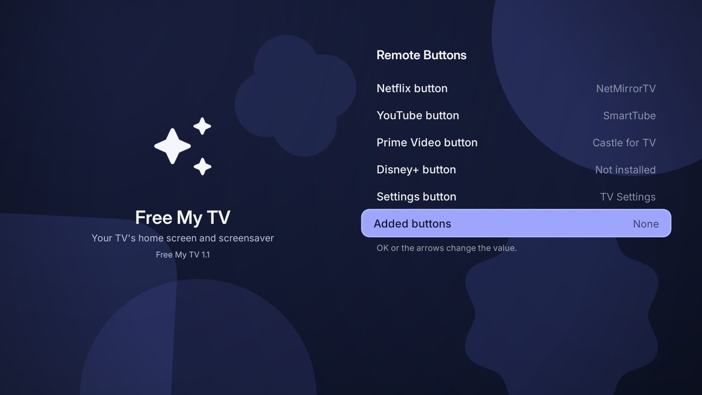 | 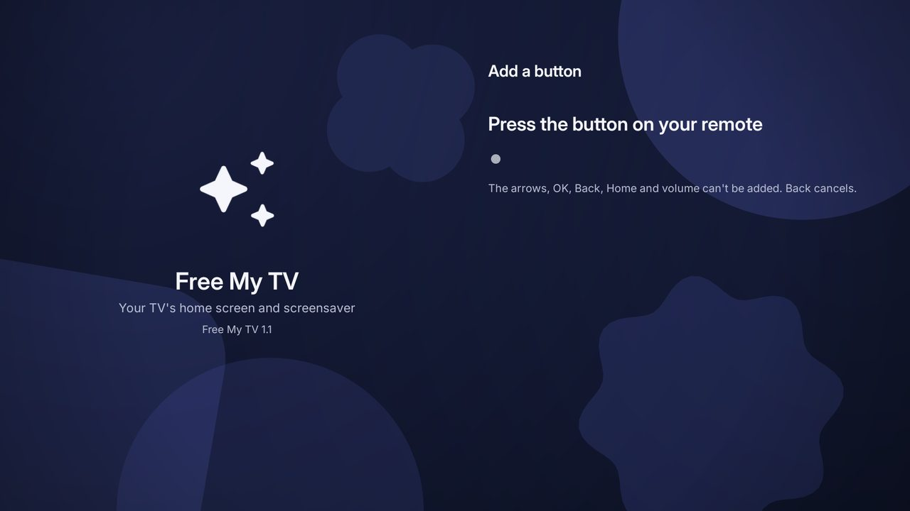 | 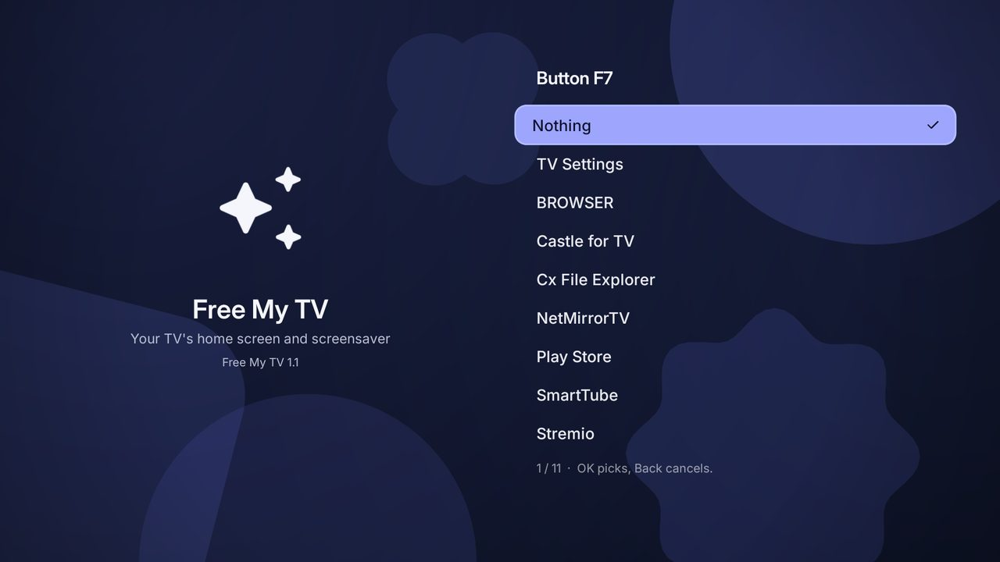 | 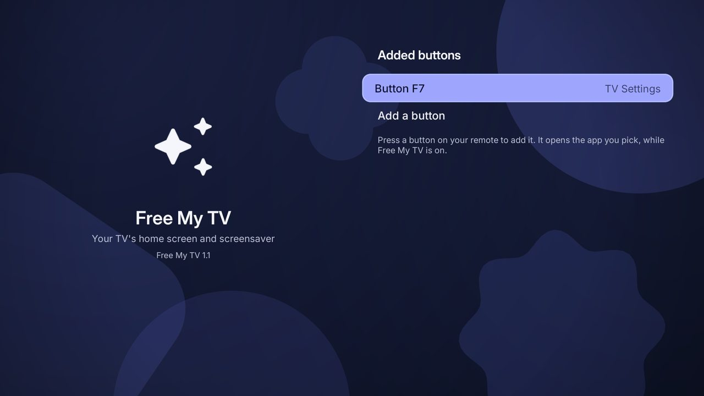 | 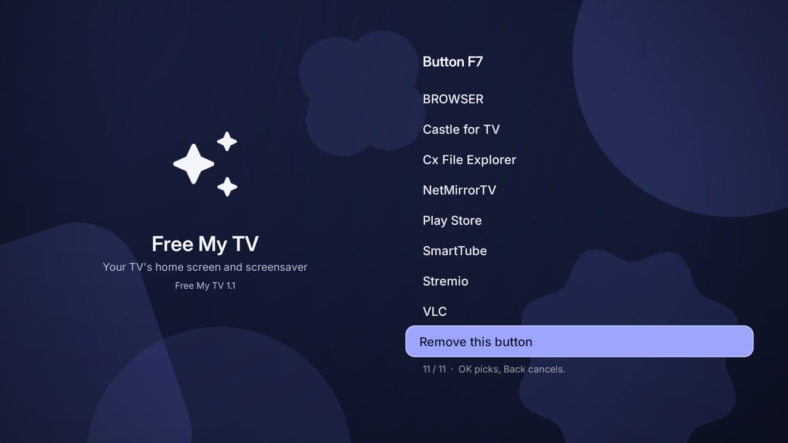 |

---

<!-- Add the next item below as "## 7. Title" with: Wanted, Where, How, To decide. When an item is built, add a **Built** line and
its screenshots (taken on the TV, saved as plans/images/minor-improvements/<item>-<what>.jpg at 1280x720). -->
